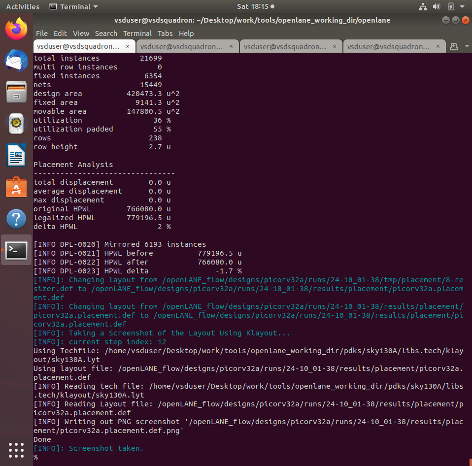
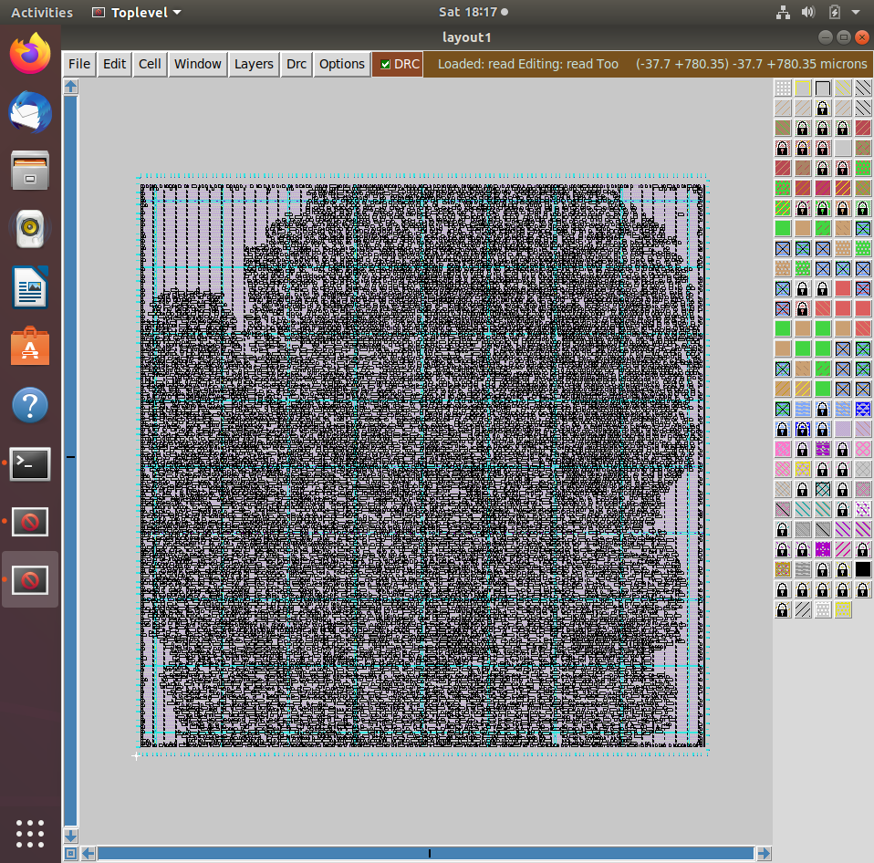
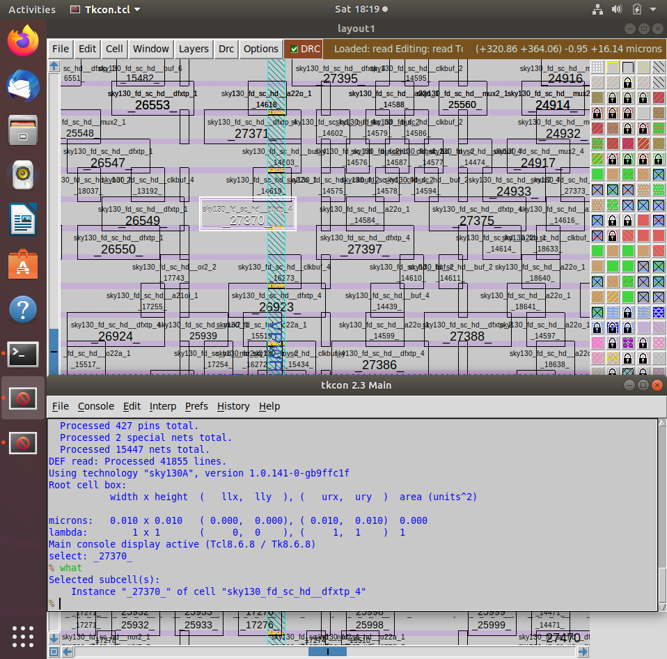
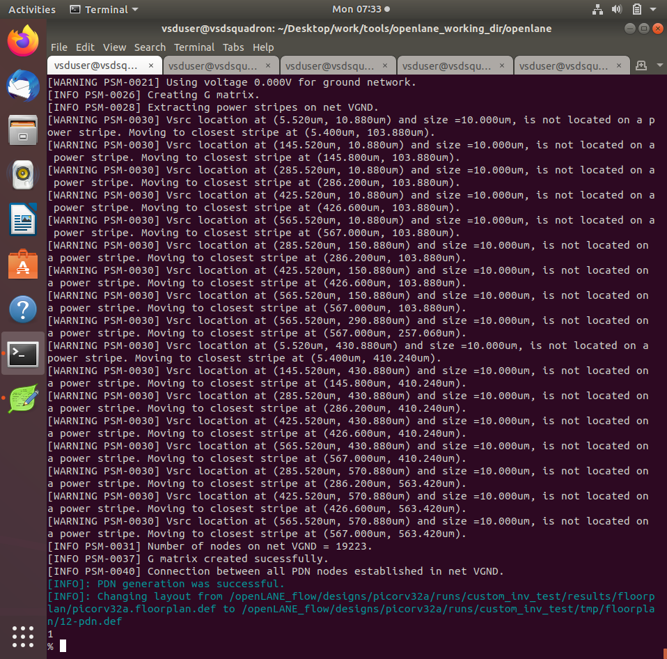
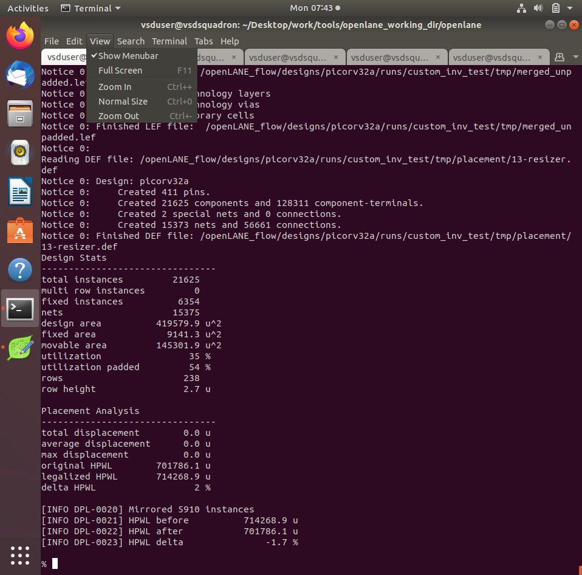
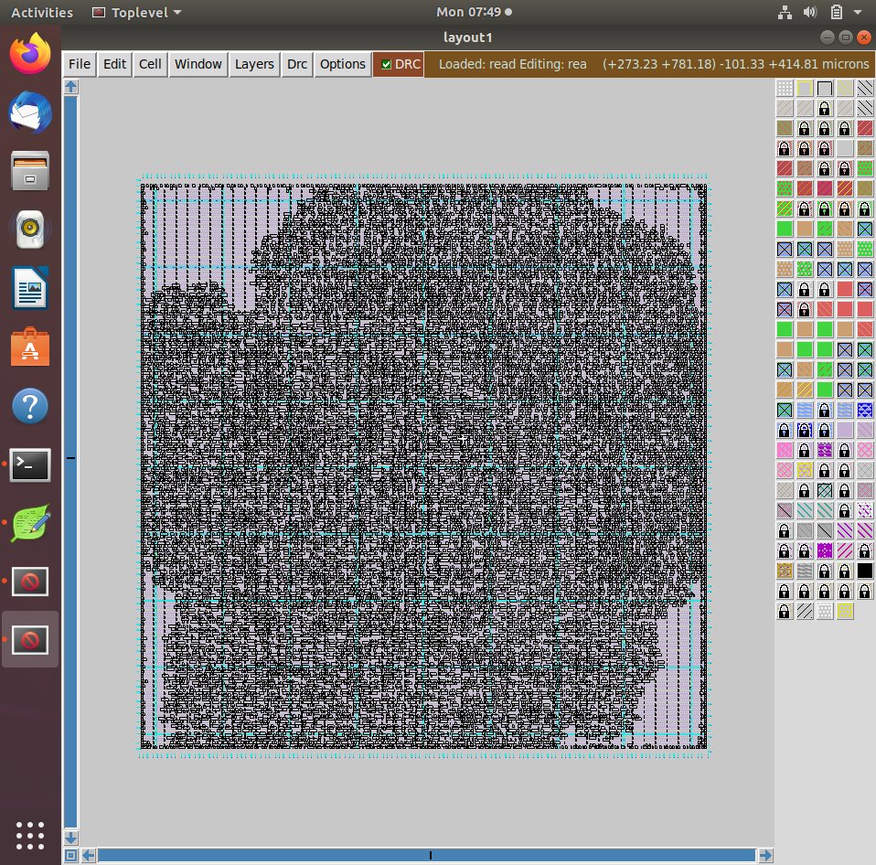
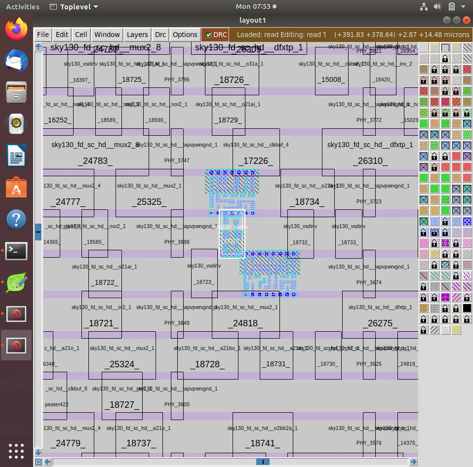

# 04 — Placement and visualization

[← Back to project README](../README.md)

## Objective and theory

**Placement** puts the mapped cells at legal coordinates within the core. At this stage, cells are positioned but the detailed signal wires are not yet routed.

## Commands / checkpoints

The following are representative commands; some screenshots come from different experiments, not one uninterrupted run.

```tcl
run_placement
# View the generated DEF with your configured Magic/physical viewer
```

## Screenshot-by-screenshot explanation

### Step 1 — Run placement

Placement assigns locations to standard-cell instances while respecting row/site and legalization constraints. The goal is a routable arrangement with manageable wire length and congestion.



### Step 2 — Placed core overview

The resulting physical layout is densely populated with standard cells. Placement organizes the mapped netlist into rows; cell connections still require later routing.



### Step 3 — Inspect placement detail

Zooming into placement reveals individual cell locations and whitespace. Close inspection can expose overlaps, irregular rows, or cells of interest before routing.



### Step 4 — Floorplan succeeds with custom library

After the custom-cell integration changes, the floorplan stage successfully completes again. This verifies that the physical setup can progress with the updated technology inputs.



### Step 5 — Placement succeeds with custom library

The global placement stage reports success in the custom-inverter run. A successful placement log verifies execution of this stage, not timing closure.



### Step 6 — Magic view of placed processor

Magic shows the full placed implementation at chip/core scale. This overview is useful for observing overall density before zooming into an individual library instance.



### Step 7 — Find `sky130_vsdinv` in placement

Zooming in reveals a `sky130_vsdinv` instance next to SKY130 standard cells. This is direct layout evidence that the custom cell has been incorporated into the placed design.


### Step 8 — Inspect inverter instance geometry

Expanding the highlighted cell shows its actual layout layers in context. It helps check that the custom inverter is aligned with the standard-cell rows and visible in the physical database.



## Key takeaway

Placement completed and the custom cell was visible in the physical layout, but routing and timing checks remained separate tasks.
