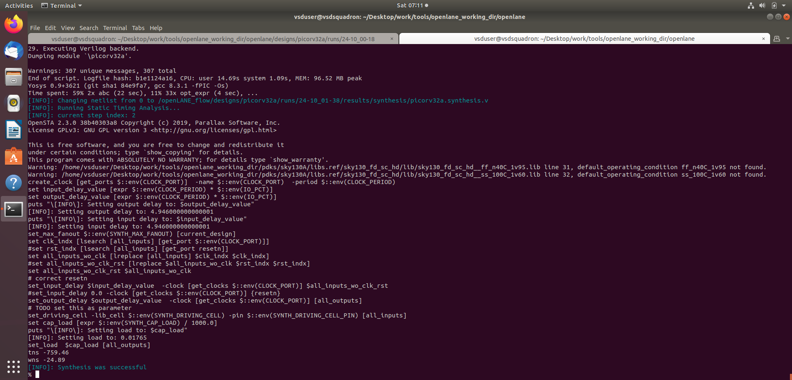
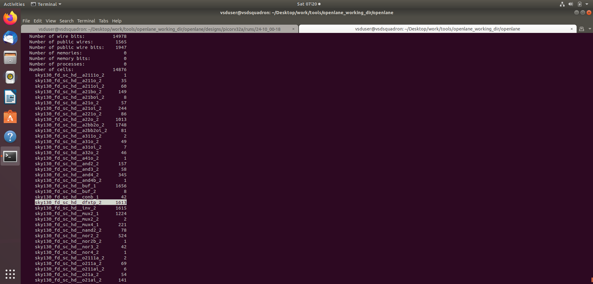
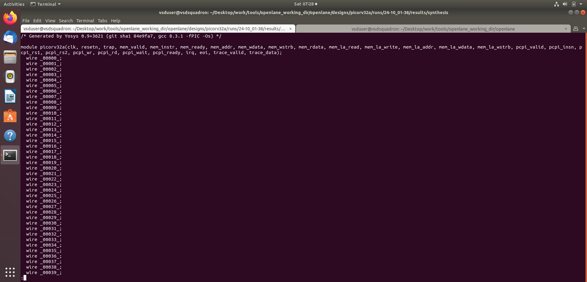
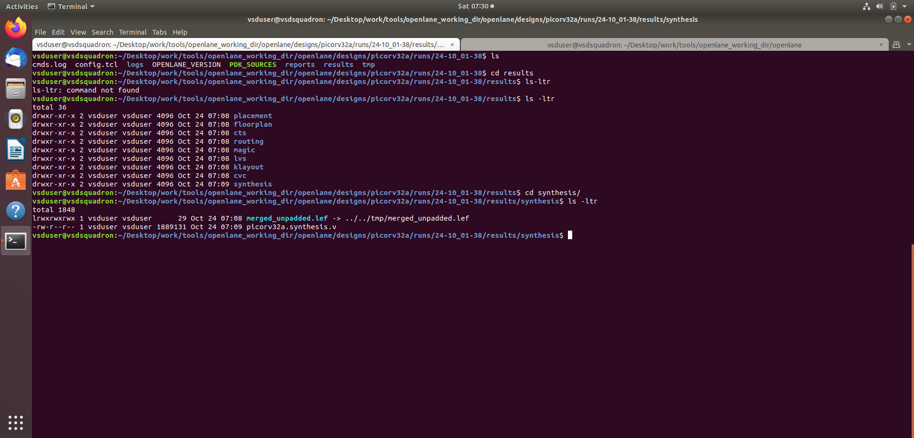
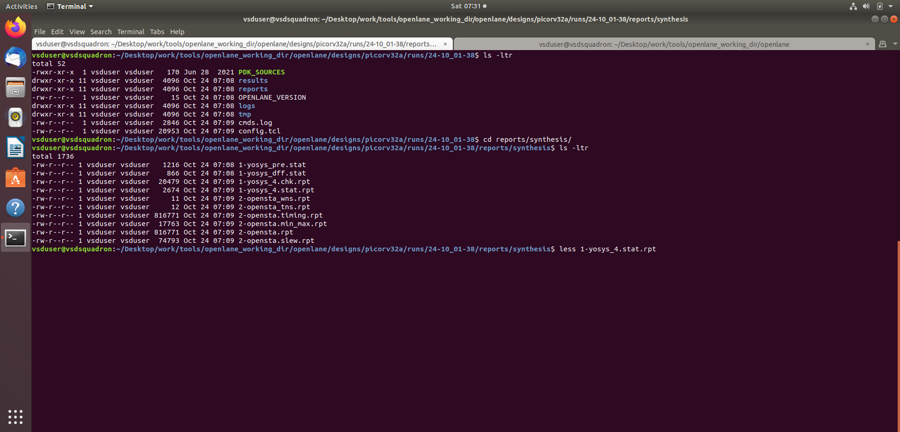
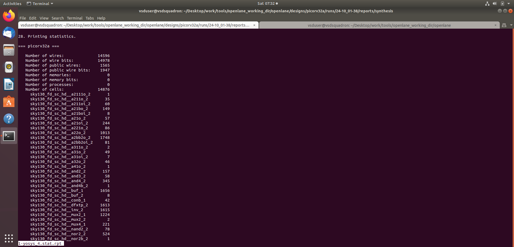
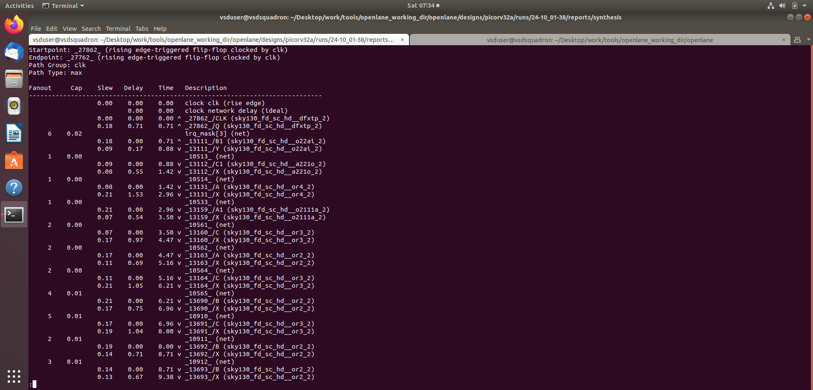
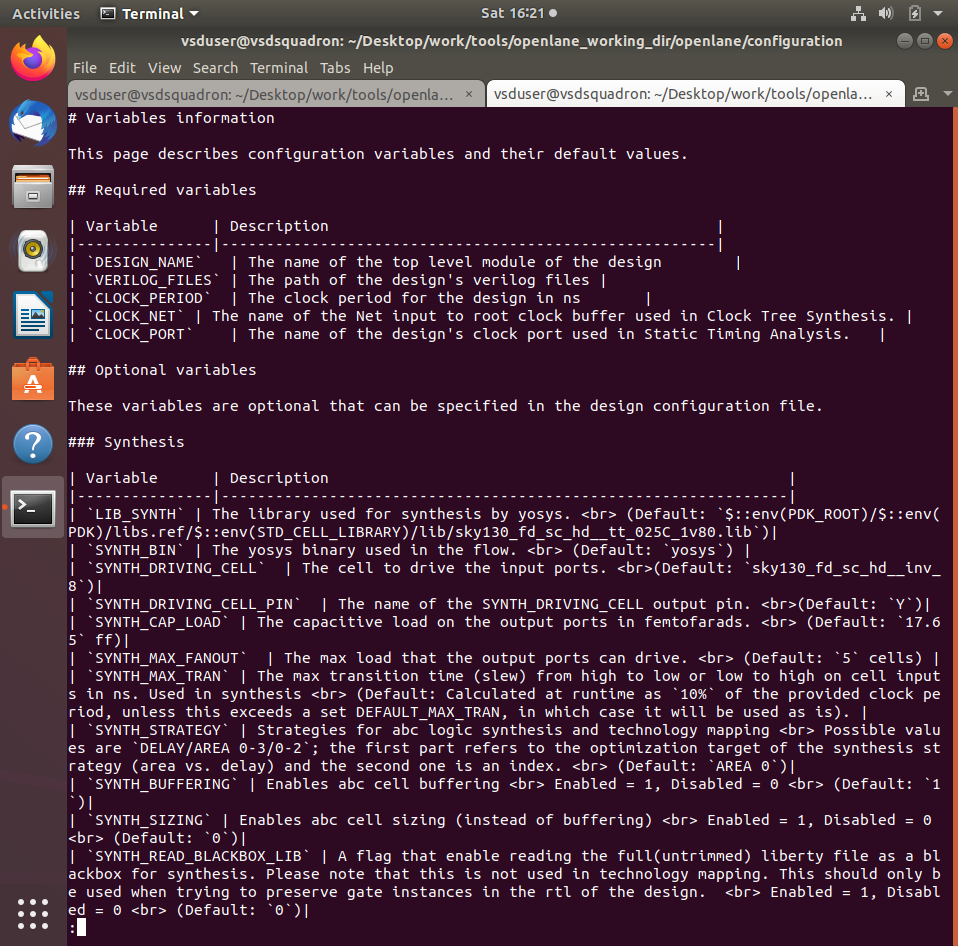

# 02 — RTL synthesis and baseline timing

[← Back to project README](../README.md)

## Objective and theory

**RTL synthesis** translates behavioral Verilog into an interconnected gate-level netlist. Mapping uses SKY130 library cells and timing constraints to choose an implementation; STA then identifies potentially slow paths.

## Commands / checkpoints

The following are representative commands; some screenshots come from different experiments, not one uninterrupted run.

```tcl
run_synthesis
# Inspect results and reports:
ls designs/picorv32a/runs/<run_id>/results/synthesis
ls designs/picorv32a/runs/<run_id>/reports/synthesis
```

## Screenshot-by-screenshot explanation

### Step 1 — Successful synthesis

Yosys maps RTL operations and registers into SKY130 standard cells. The synthesis-success message confirms netlist creation; it does not by itself prove that timing constraints are met.



### Step 2 — Sequential logic statistics

The synthesis statistics enumerate mapped cell types and sequential elements. Flip-flops store processor state; combinational gates implement its datapath and control logic.



### Step 3 — Generated synthesized netlist

The `results/synthesis` folder contains a synthesized Verilog netlist and a merged LEF reference. The netlist is the structural input for floorplanning and later physical-design stages.



### Step 4 — Inspect gate-level Verilog

The Yosys-generated Verilog lists intermediate wires and standard-cell instances rather than high-level RTL behavior. This illustrates technology mapping from source code to actual library cells.



### Step 5 — Locate synthesis reports

Synthesis produces cell statistics and OpenSTA reports under `reports/synthesis`. Keeping the report filename and run directory allows timing results to be traced to a specific configuration.



### Step 6 — Cell count and mapping distribution

The baseline report shows **14,876 mapped cells**, including **1,613 `sky130_fd_sc_hd__dfxtp_2`** flip-flops. Cell distribution helps identify area usage and the ratio of sequential versus combinational logic.



### Step 7 — Critical timing path

A max-delay timing report traces a register-to-register path through combinational cells. Arrival time versus required time determines setup slack; a negative value is a timing violation.



### Step 8 — Synthesis parameter reference

The legacy OpenLANE configuration reference explains variables such as synthesis fanout, driving cell, capacitance load, and I/O timing assumptions. These settings should be chosen consistently with the intended design scenario.



## Key takeaway

Synthesis succeeded and produced a mapped netlist; timing analysis remains necessary to evaluate performance.
